# 🚀 Práctica Guiada: Preparación y Evaluación de Imágenes para Visión Artificial

> **Nivel:** Básico – Principiante (Desde cero)  
> **Duración:** 2 horas  
> **Asignatura:** Soluciona problemas de Visión Artificial  
> **Especialidad:** Inteligencia Artificial  
> **Semestre:** 3º de Preparatoria  
> **Herramientas:** Python, Visual Studio Code, OpenCV y NumPy.

---

## 🎯 1. Propósito de la Práctica
El objetivo es que comprendas **cómo preparar un conjunto de imágenes** antes de alimentarlas a un modelo de Inteligencia Artificial. Al final, serás capaz de:

- ✅ Identificar el tamaño y formato de las imágenes.
- ✅ Organizar imágenes en carpetas por categoría.
- ✅ Cambiar el tamaño de las imágenes a dimensiones uniformes.
- ✅ Convertir imágenes a un formato común.
- ✅ Normalizar los valores de los píxeles (¡la comida favorita de la IA!).
- ✅ Evaluar que las imágenes procesadas cumplan con los criterios establecidos.

**📦 Producto esperado:** Un conjunto de imágenes organizado, redimensionado, convertido y normalizado, acompañado de un reporte automático generado con Python.

---

## 🧠 2. Conceptos Básicos (¡Sin tecnicismos!)

Antes de escribir código, entendamos el "porqué" con una analogía: *Imagina que la IA es un chef que solo sabe cocinar si todos los ingredientes están cortados en cubos exactos de 1 cm y medidos en gramos. Si le das una papa entera o una medida en tazas, ¡la receta fallará!*

| Concepto | Explicación sencilla | Ejemplo |
| :--- | :--- | :--- |
| **Tamaño de imagen** | Cantidad de píxeles (puntitos de color) que forman la imagen. | 640 × 480 píxeles |
| **Formato** | El "apellido" del archivo que indica cómo está guardado. | `.jpg`, `.png`, `.bmp` |
| **Redimensionamiento** | Estirar o encoger la imagen a un ancho y alto específicos. | 224 × 224 píxeles |
| **Normalización** | Cambiar los valores de color (0-255) a un rango pequeño (0-1) para que la IA calcule más rápido. | De `128` a `0.502` |
| **Organización** | Clasificar imágenes en carpetas según lo que muestran. | Carpeta `gatos` y `perros` |
| **Evaluación** | Comprobar automáticamente que todo el proceso salió bien. | Verificar que mida 224×224 y sea legible |

---

## 🎒 3. Materiales Necesarios
- [ ] Computadora con Windows.
- [ ] Visual Studio Code (VS Code) instalado.
- [ ] Python instalado (versión 3.8 o superior).
- [ ] 10 imágenes digitales: 5 de una categoría (ej. gatos) y 5 de otra (ej. perros).  
  *(💡 Tip: Descárgalas de internet, asegúrate de que sean claras, diferentes entre sí y sin marcas de agua. No importa si tienen tamaños distintos).*

---

## 💻 4. Configuración del Proyecto (Paso a Paso)

Trabajaremos en un proyecto llamado `u3-p4-prep-img-0777`. Sigue estos pasos en orden:

### Paso 1: Abrir la terminal
1. Abre **Visual Studio Code**.
2. Ve al menú superior: **Terminal → Nueva Terminal**.
3. Asegúrate de que a la izquierda de la terminal diga `PowerShell`.

### Paso 2: Crear la carpeta de trabajo
Escribe estos comandos y presiona Enter` después de cada uno:

### resultados 
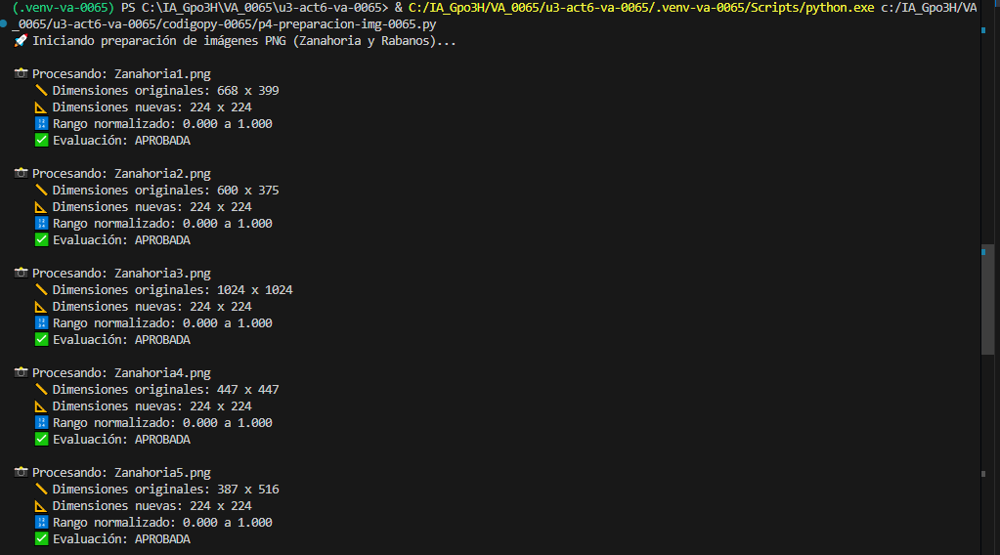
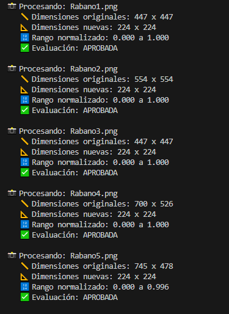
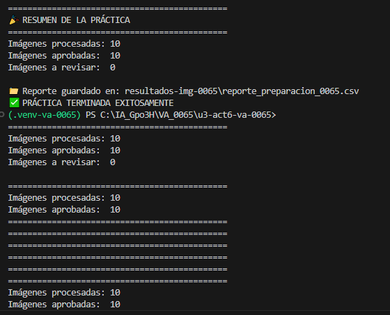

## imagen preparada
## rabano
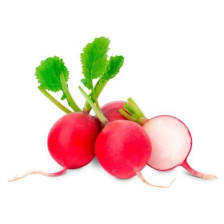
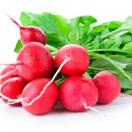
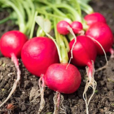
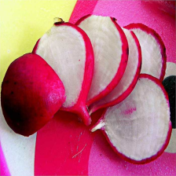
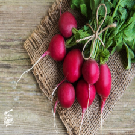

## zanahoria
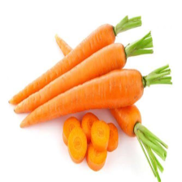
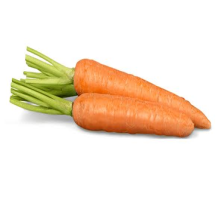
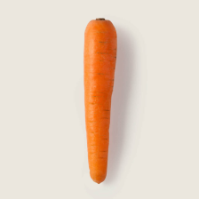
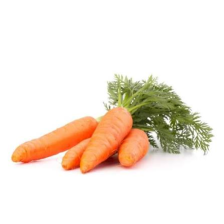
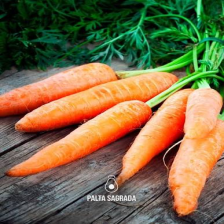

## Archivo csv
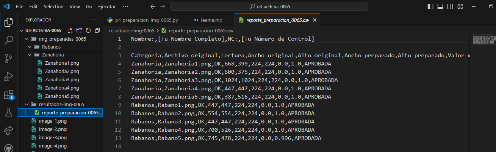